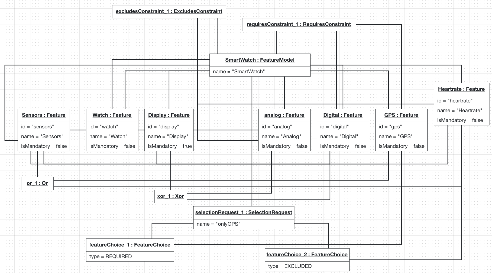
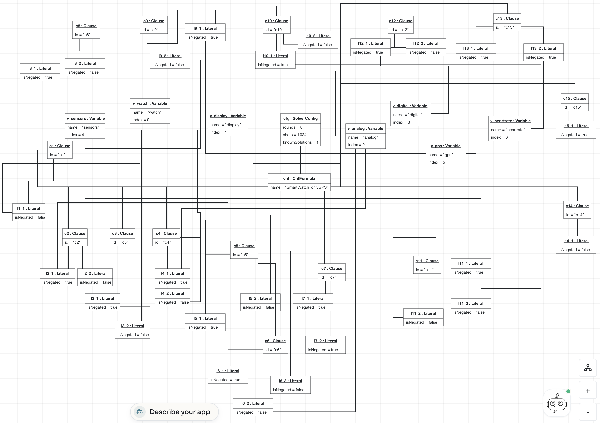

# Example: SmartWatch feature model

Hand-built example for Part I of the TACS project. The same object models are in the B-UML file [`tacs262_assignment_project-4.py`](tacs262_assignment_project-4.py) (`Object_Problema_Diagram` and `Object_Solution_Diagram`) and in the BESSER project [`TACS262_Assignment-15.json`](TACS262_Assignment-15.json). The other test instances are in [Instances.md](Instances.md).

The model has 7 features, so the CNF has 7 variables and the Grover circuit needs 7 search qubits, below the Class B limit of 12.

## 1. The feature model

```
watch (root)
├── display (mandatory)
│     └── Xor { analog, digital }
└── sensors (optional)
      └── Or { gps, heartrate }

requiresConstraint_1: gps requires digital
excludesConstraint_1: analog excludes heartrate
```

A watch always has a display, which is either analog or digital (Xor). It may have sensors and, if it does, it has GPS, a heart rate sensor or both (Or). GPS needs a digital display, and the analog display does not support the heart rate sensor.

The example covers every construct of the Problem DSL: root, mandatory and optional features, an Xor group, an Or group, a requires constraint, an excludes constraint and a selection request with both REQUIRED and EXCLUDED choices.

## 2. Problem object model

Attributes (`id`, `name`, `isMandatory`, `type`) are values stored in the object. Associations (`root`, `features`, `constraints`, `requests`, `children`, `parent`, `groups`, `group`, `members`, `source`, `target`, `choices`, `feature`) are links to other objects. Object names are the same as in the B-UML object model and in the image below.

| Object | Class | Attributes and links |
|---|---|---|
| SmartWatch | FeatureModel | name="SmartWatch", root=Watch, features={Watch, Display, analog, Digital, Sensors, GPS, Heartrate}, constraints={requiresConstraint_1, excludesConstraint_1}, requests={selectionRequest_1} |
| Watch | Feature | id="watch", name="Watch", isMandatory=false, children={Display, Sensors} |
| Display | Feature | id="display", name="Display", isMandatory=true, parent=Watch, children={analog, Digital}, groups={xor_1} |
| analog | Feature | id="analog", name="Analog", isMandatory=false, parent=Display, group=xor_1 |
| Digital | Feature | id="digital", name="Digital", isMandatory=false, parent=Display, group=xor_1 |
| Sensors | Feature | id="sensors", name="Sensors", isMandatory=false, parent=Watch, children={GPS, Heartrate}, groups={or_1} |
| GPS | Feature | id="gps", name="GPS", isMandatory=false, parent=Sensors, group=or_1 |
| Heartrate | Feature | id="heartrate", name="Heartrate", isMandatory=false, parent=Sensors, group=or_1 |
| xor_1 | Xor | parent=Display, members={analog, Digital} |
| or_1 | Or | parent=Sensors, members={GPS, Heartrate} |
| requiresConstraint_1 | RequiresConstraint | source=GPS, target=Digital |
| excludesConstraint_1 | ExcludesConstraint | source=analog, target=Heartrate |
| selectionRequest_1 | SelectionRequest | name="onlyGPS", choices={featureChoice_1, featureChoice_2} |
| featureChoice_1 | FeatureChoice | type=REQUIRED, feature=GPS |
| featureChoice_2 | FeatureChoice | type=EXCLUDED, feature=Heartrate |

## 3. Solution object model

### 3.1 Formula

```
cnf : CnfFormula   name="SmartWatch_onlyGPS"
                   variables={v_watch, ..., v_heartrate}
                   clauses={c1, ..., c15}
                   solverconfig=cfg
```

### 3.2 Variables

Each feature becomes one Variable. The `index` is the position of its qubit in the circuit.

| Object | name | index |
|---|---|---|
| v_watch | watch | 0 |
| v_display | display | 1 |
| v_analog | analog | 2 |
| v_digital | digital | 3 |
| v_sensors | sensors | 4 |
| v_gps | gps | 5 |
| v_heartrate | heartrate | 6 |

### 3.3 Clauses

Each row is one Clause object and each term is one Literal object. The rule "child implies parent" (¬C ∨ P) is produced both by optional features and by group members, so duplicated clauses appear only once. Each clause follows the mapping rules of the Problem DSL concept table ([problem_dsl_table.png](images/problem_dsl_table.png)), taken from Batory (2005).

| id | Clause | Origin |
|---|---|---|
| c1 | watch | root is always selected |
| c2 | ¬display ∨ watch | child implies parent |
| c3 | ¬watch ∨ display | display is mandatory |
| c4 | ¬analog ∨ display | child implies parent |
| c5 | ¬digital ∨ display | child implies parent |
| c6 | ¬display ∨ analog ∨ digital | xor_1: at least one member |
| c7 | ¬analog ∨ ¬digital | xor_1: at most one member |
| c8 | ¬sensors ∨ watch | child implies parent |
| c9 | ¬gps ∨ sensors | child implies parent |
| c10 | ¬heartrate ∨ sensors | child implies parent |
| c11 | ¬sensors ∨ gps ∨ heartrate | or_1: at least one member |
| c12 | ¬gps ∨ digital | requiresConstraint_1 |
| c13 | ¬analog ∨ ¬heartrate | excludesConstraint_1 |
| c14 | gps | featureChoice_1 (REQUIRED) |
| c15 | ¬heartrate | featureChoice_2 (EXCLUDED) |

Example of one clause written as objects (c12 ( ¬gps ∨ digital)):

```
c12  : Clause    id="c12"   literals={l12_1, l12_2}
l12_1 : Literal   isNegated=true    target=v_gps
l12_2 : Literal   isNegated=false   target=v_digital
```

### 3.4 Solver configuration

```
cfg : SolverConfig   knownSolutions=1   rounds=8   shots=1024
```

The number of Grover rounds is ⌊π/4 · √(N/M)⌋ (Boyer et al., 1998), with N = 2^7 = 128 states and M = 1 solution, which gives 8. M was checked by brute force over the 128 assignments.

### 3.5 Expected result

A single valid configuration: **watch, display, digital, sensors, gps**.

## Object Models

### Object Problem model



Note: in the BESSER-generated file `tacs262_assignment_project-4.py`, the six `parent/children` links of this model are written as self-links (for example `display_obj.children = display_obj`). The links are correct in the BESSER project (`TACS262_Assignment-15.json`) and in the image above (Display→Watch, Sensors→Watch, analog→Display, Digital→Display, GPS→Sensors, Heartrate→Sensors), and the table in section 2 follows them.

### Object Solution model



## References

- D. Batory, "Feature models, grammars, and propositional formulas", SPLC 2005, LNCS 3714, pp. 7–20.
- M. Boyer, G. Brassard, P. Høyer, A. Tapp, "Tight bounds on quantum searching", Fortschritte der Physik 46, 1998.

