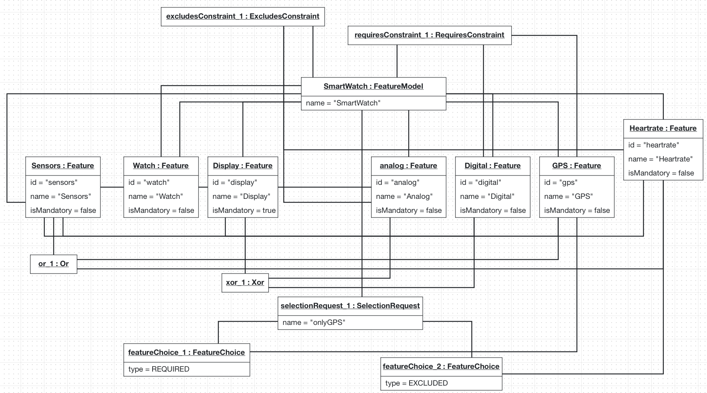
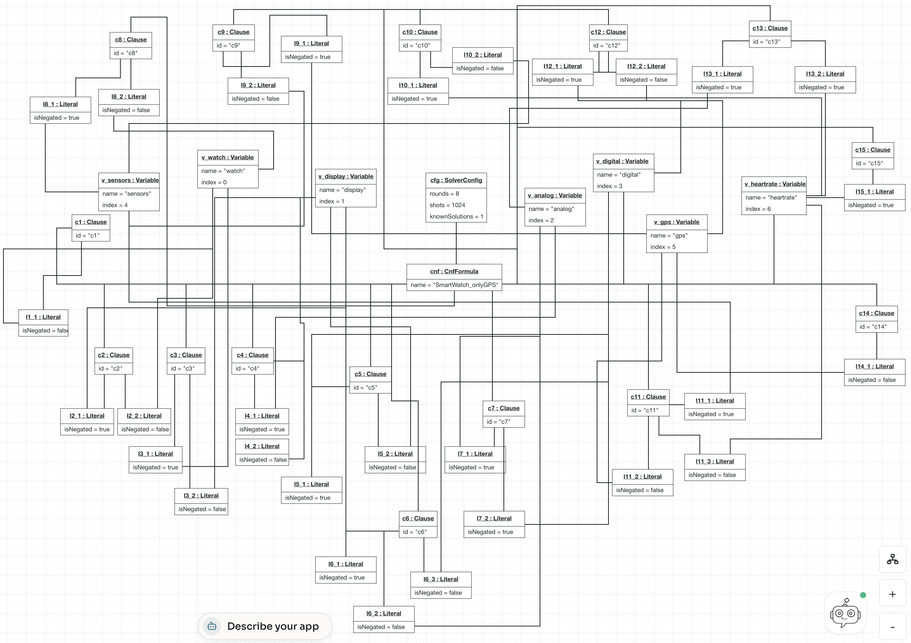

# Example: SmartWatch feature model

Main example of the project: a hand-built problem object model and the solution object model that T1 must produce from it. The other test instances, all from the same SmartWatch product line, are in [Instances.md](Instances.md) (this example is I3). The model has 11 features, so the CNF has 11 variables and the Grover circuit needs 11 search qubits, within the Class B scope of about 12 search qubits.

> **Status of the other artefacts.** The B-UML object models in [`tacs262_assignment_project-4.py`](tacs262_assignment_project-4.py) (`Object_Problema_Diagram` and `Object_Solution_Diagram`) follow this file. The BESSER project [`TACS262_Assignment-15.json`](TACS262_Assignment-15.json) and the images at the end of this file still show the earlier 7-feature version (15 clauses, 1 solution, 8 rounds) and are to be updated in the BESSER web editor.

## 1. The feature model

```
watch (root)
├── display (mandatory)
│     └── Xor { analog, digital }
│                        ├── battery (mandatory)
│                        ├── temperature (optional)
│                        ├── steps (optional)
│                        └── weather (optional)
└── sensors (optional)
      └── Or { gps, heartrate }

requiresConstraint_1: gps requires digital
excludesConstraint_1: analog excludes heartrate
```

A watch always has a display, which is either analog or digital (Xor). A digital display always shows the battery level and may show the temperature, the step count and distance, and the weather. The watch may have sensors and, if it does, it has GPS, a heart rate sensor or both (Or). GPS needs a digital display, and the analog display does not support the heart rate sensor.

The example covers every construct of the Problem DSL: root, mandatory and optional features, an Xor group, an Or group, a requires constraint, an excludes constraint and a selection request with both REQUIRED and EXCLUDED choices.

### 1.1 Why these features

The data items shown on a digital display (`battery`, `temperature`, `steps`, `weather`) are the four data types that smartwatch wearers display most often on their watch face, according to a survey of 237 wearers by Islam et al. (2020, Fig. 4):

| Feature | Data type in Islam et al. (2020) | Wearers who display it (of 237) |
|---|---|---|
| battery | Watch battery level | 165 (1st) |
| temperature | Temperature | 158 (2nd) |
| steps | Step count / Distance traveled | 147 (3rd) / 70 |
| weather | Weather info | 143 (4th) |

The same survey reports that 47 of the 54 smartwatch models used by the respondents have a heart rate sensor (§4.3), and 104 respondents display heart rate data on their watch face.

Modelling decisions of the group:

- `battery` is mandatory: the wearer always needs to know when to charge the watch.
- Step count and distance traveled are one feature (`steps`), because both come from the same activity tracking.
- Heart rate appears only once, as a sensor in the Or group of `sensors`.

## 2. Problem object model

Object names follow the B-UML object model.

| Object | Class | Attributes and links |
|---|---|---|
| SmartWatch | FeatureModel | name="SmartWatch", root=Watch, features={Watch, Display, analog, Digital, Battery, Temperature, Steps, Weather, Sensors, GPS, Heartrate}, constraints={requiresConstraint_1, excludesConstraint_1}, requests={selectionRequest_1} |
| Watch | Feature | id="watch", name="Watch", isMandatory=false, children={Display, Sensors} |
| Display | Feature | id="display", name="Display", isMandatory=true, parent=Watch, children={analog, Digital}, groups={xor_1} |
| analog | Feature | id="analog", name="Analog", isMandatory=false, parent=Display, group=xor_1 |
| Digital | Feature | id="digital", name="Digital", isMandatory=false, parent=Display, group=xor_1, children={Battery, Temperature, Steps, Weather} |
| Battery | Feature | id="battery", name="Battery", isMandatory=true, parent=Digital |
| Temperature | Feature | id="temperature", name="Temperature", isMandatory=false, parent=Digital |
| Steps | Feature | id="steps", name="StepsDistance", isMandatory=false, parent=Digital |
| Weather | Feature | id="weather", name="Weather", isMandatory=false, parent=Digital |
| Sensors | Feature | id="sensors", name="Sensors", isMandatory=false, parent=Watch, children={GPS, Heartrate}, groups={or_1} |
| GPS | Feature | id="gps", name="GPS", isMandatory=false, parent=Sensors, group=or_1 |
| Heartrate | Feature | id="heartrate", name="Heartrate", isMandatory=false, parent=Sensors, group=or_1 |
| xor_1 | Xor | parent=Display, members={analog, Digital} |
| or_1 | Or | parent=Sensors, members={GPS, Heartrate} |
| requiresConstraint_1 | RequiresConstraint | source=GPS, target=Digital |
| excludesConstraint_1 | ExcludesConstraint | source=analog, target=Heartrate |
| selectionRequest_1 | SelectionRequest | name="onlyGPS", choices={featureChoice_1, featureChoice_2} |
| featureChoice_1 | FeatureChoice | type=REQUIRED, feature=GPS |
| featureChoice_2 | FeatureChoice | type=EXCLUDED, feature=Heartrate |

## 3. Solution object model

### 3.1 Formula

```
cnf : CnfFormula   name="SmartWatch_onlyGPS"
                   variables={v_watch, ..., v_weather}
                   clauses={c1, ..., c20}
                   solverconfig=cfg
```

### 3.2 Variables

Each feature becomes one Variable. The `index` is the position of its qubit in the circuit. The variables of the earlier 7-feature version keep their indices (0–6); the new ones take 7–10.

| Object | name | index |
|---|---|---|
| v_watch | watch | 0 |
| v_display | display | 1 |
| v_analog | analog | 2 |
| v_digital | digital | 3 |
| v_sensors | sensors | 4 |
| v_gps | gps | 5 |
| v_heartrate | heartrate | 6 |
| v_battery | battery | 7 |
| v_temperature | temperature | 8 |
| v_steps | steps | 9 |
| v_weather | weather | 10 |

### 3.3 Clauses

Each row is one Clause object and each term is one Literal object (CNF as defined in Annex A of the assignment and in the course slides [S]). Each clause follows the mapping rules of the Problem DSL concept table ([problem_dsl_table.png](images/problem_dsl_table.png)), taken from Batory (2005). The rule "child implies parent" (¬C ∨ P) is produced both by optional features and by group members, so it appears only once per child.

| id | Clause | Origin |
|---|---|---|
| c1 | watch | root |
| c2 | ¬watch ∨ display | display mandatory |
| c3 | ¬display ∨ watch | child implies parent |
| c4 | ¬display ∨ analog ∨ digital | xor_1: at least one member |
| c5 | ¬analog ∨ display | child implies parent |
| c6 | ¬digital ∨ display | child implies parent |
| c7 | ¬analog ∨ ¬digital | xor_1: at most one member |
| c8 | ¬digital ∨ battery | battery mandatory |
| c9 | ¬battery ∨ digital | child implies parent |
| c10 | ¬temperature ∨ digital | child implies parent |
| c11 | ¬steps ∨ digital | child implies parent |
| c12 | ¬weather ∨ digital | child implies parent |
| c13 | ¬sensors ∨ watch | child implies parent |
| c14 | ¬sensors ∨ gps ∨ heartrate | or_1: at least one member |
| c15 | ¬gps ∨ sensors | child implies parent |
| c16 | ¬heartrate ∨ sensors | child implies parent |
| c17 | ¬gps ∨ digital | requiresConstraint_1 |
| c18 | ¬analog ∨ ¬heartrate | excludesConstraint_1 |
| c19 | gps | featureChoice_1 (REQUIRED) |
| c20 | ¬heartrate | featureChoice_2 (EXCLUDED) |

Example of one clause written as objects (c17 (¬gps ∨ digital)):

```
c17   : Clause    id="c17"   literals={l17_1, l17_2}
l17_1 : Literal   isNegated=true    target=v_gps
l17_2 : Literal   isNegated=false   target=v_digital
```

### 3.4 Solver configuration

```
cfg : SolverConfig   knownSolutions=8   rounds=12   shots=1024
```

The number of Grover rounds is ⌊π/4 · √(N/M)⌋ (Boyer et al., 1998), with N = 2^11 = 2048 states and M = 8 solutions: ⌊π/4 · 16⌋ = 12. M was counted by brute force over the 2048 assignments. Without the selection request the feature model has 33 valid configurations.

### 3.5 Expected result

Eight valid configurations. All of them contain **watch, display, digital, battery, sensors, gps**; they differ only in the three optional data items of the digital display:

| # | temperature | steps | weather |
|---|---|---|---|
| 1 | | | |
| 2 | | | ✓ |
| 3 | | ✓ | |
| 4 | | ✓ | ✓ |
| 5 | ✓ | | |
| 6 | ✓ | | ✓ |
| 7 | ✓ | ✓ | |
| 8 | ✓ | ✓ | ✓ |

The REQUIRED `gps` forces `sensors` and, through requiresConstraint_1, `digital`; `digital` excludes `analog` and forces `battery`. The EXCLUDED `heartrate` leaves `gps` as the only member of or_1.

### 3.6 Output of T1

T1 (Part II) produces this solution model from the problem model above: [Part2/generated/I3_SmartWatch_onlyGPS.py](../Part2/generated/I3_SmartWatch_onlyGPS.py). It has the same 20 clauses and the same SolverConfig (checked by [Part2/test_part2.py](../Part2/test_part2.py)). Only the numbering differs: T1 numbers the variables in depth-first order of the tree (watch 0, display 1, analog 2, digital 3, battery 4, steps 5, temperature 6, weather 7, sensors 8, gps 9, heartrate 10) and the clauses in the order of its rules. See [Part2/README.md](../Part2/README.md).

## Object models (earlier 7-feature version)

These images show the earlier version of the example (without battery, temperature, steps and weather) and are to be updated.

### Object Problem model



Note: the BESSER export of this earlier version wrote the six `parent/children` links as self-links (for example `display_obj.children = display_obj`). The links are correct in the BESSER project (`TACS262_Assignment-15.json`) and in the image above, and they were corrected in `tacs262_assignment_project-4.py` when the model was extended.

### Object Solution model



## References

- D. Batory, "Feature models, grammars, and propositional formulas", SPLC 2005, LNCS 3714, pp. 7–20.
- A. Islam, A. Bezerianos, B. Lee, T. Blascheck, P. Isenberg, "Visualizing information on watch faces: A survey with smartwatch users", IEEE VIS 2020 (Short Papers), doi:10.1109/VIS47514.2020.00038. Preprint: arXiv:2009.00750.
- M. Boyer, G. Brassard, P. Høyer, A. Tapp, "Tight bounds on quantum searching", Fortschritte der Physik 46, 1998.
- [S] J. Pascoal Faria, J. Cunha, "Quantum computing: a brief introduction", TACS 2026/27 slides, 2026.
